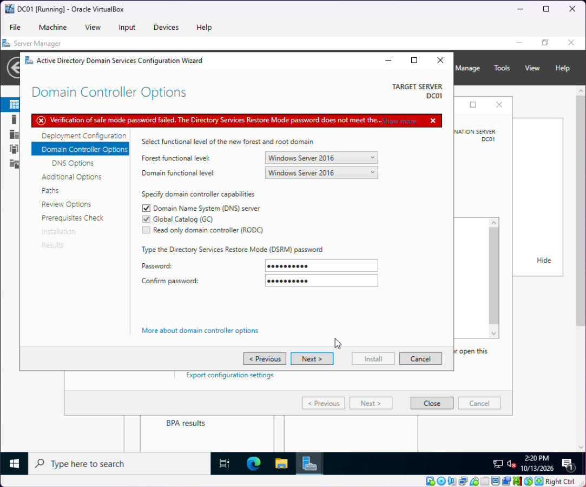

# 1. Domain Controller Setup (DC01)

## VM configuration

| Setting | Value |
|---|---|
| OS | Windows Server 2022 (Desktop Experience) |
| RAM / CPU / Disk | 4 GB / 2 CPUs / 50 GB |
| Adapter 1 | NAT (internet) |
| Adapter 2 | Host-only (`192.168.56.0/24`) |

## Steps

1. Created the DC01 VM in VirtualBox and installed Windows Server 2022 with Desktop Experience.
2. Renamed the server to **DC01**.
3. Set a **static IP** on the host-only adapter:
   - IP: `192.168.56.10`
   - Subnet mask: `255.255.255.0`
   - Preferred DNS: `192.168.56.10` (itself, since it will be the DNS server)
4. Installed the **Active Directory Domain Services** role through Server Manager.
5. Promoted DC01 to a domain controller:
   - New forest, root domain `lab.local`
   - NetBIOS name `LAB`
   - DNS Server and Global Catalog enabled
6. Reviewed the prerequisite check warnings before promotion:
   - **NT 4.0 cryptography algorithms:** default security hardening notice, expected
   - **Adapter using DHCP:** the NAT adapter gets its address from DHCP; the lab adapter is static, so this is fine
   - **DNS delegation can't be created:** expected for a new, non-public `.local` domain with no parent zone

All three are normal for an isolated lab and don't affect the domain.

### Issue during promotion: DSRM password rejected

On the Domain Controller Options page, the wizard rejected the Directory Services Restore Mode (DSRM) password because it didn't meet the domain's complexity requirements. The DSRM password is the emergency local login used to boot a DC into recovery mode, so Windows enforces the same complexity rules as other accounts (length plus a mix of uppercase, lowercase, numbers and symbols). Entering a stronger password cleared the error and the wizard continued.

## Verification

After the reboot, logged in as `LAB\Administrator` and confirmed AD DS and DNS were running in Server Manager.

PowerShell equivalent: [`scripts/01-setup-dc.ps1`](../scripts/01-setup-dc.ps1)
