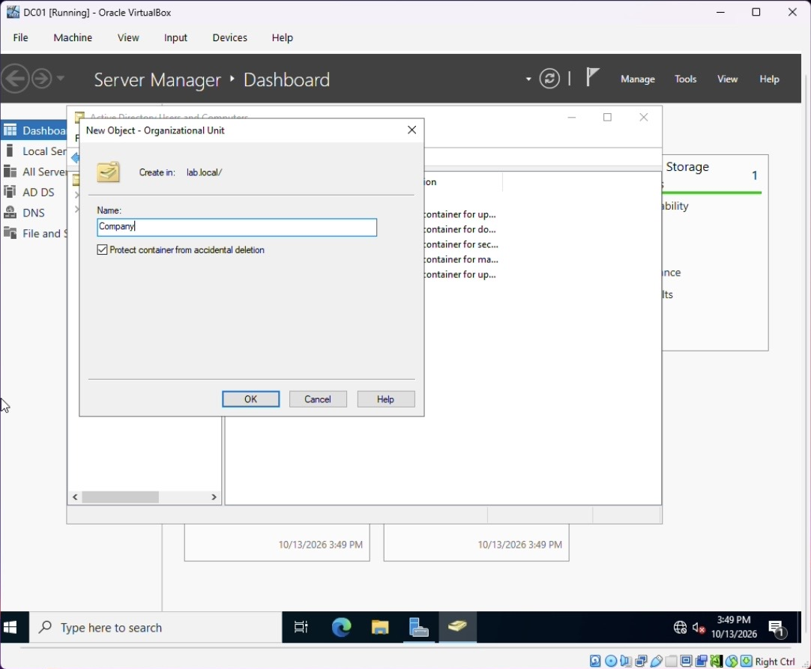
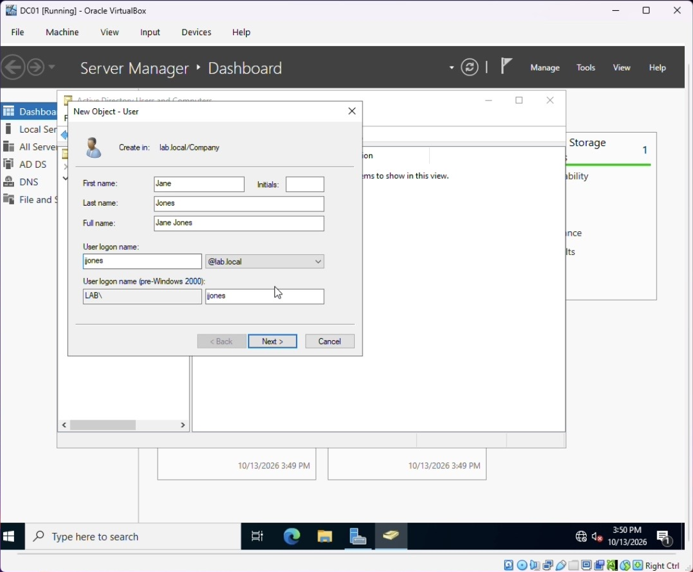
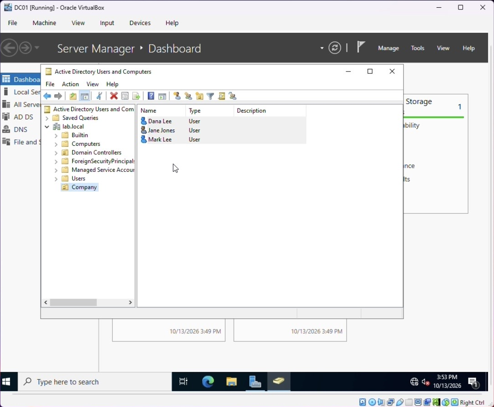

# 2. Active Directory Management

All of this was done in **Active Directory Users and Computers (ADUC)** on DC01.

## Organizational Unit

Created an OU named **Company** to hold the lab's users and groups, separate from the built-in `Users` container. I left **Protect container from accidental deletion** checked, which is the default and good practice. OUs make it possible to apply Group Policy and delegate permissions to a specific set of objects.

## Users

| Name | Username |
|---|---|
| Jane Jones | `jjones` |
| Mark Lee | `mlee` |
| Dana Lee | `dlee` |

Each user was created inside the Company OU with the **New Object – User** wizard, which sets both the modern logon name (`jjones@lab.local`) and the pre-Windows 2000 name (`LAB\jjones`).

## Security group

Created a **Sales** security group in the Company OU and added users to it. In a real environment, permissions to shared folders and resources are assigned to groups, not individual users, so access follows the role.

PowerShell equivalent: [`scripts/02-create-ou-users-groups.ps1`](../scripts/02-create-ou-users-groups.ps1)
