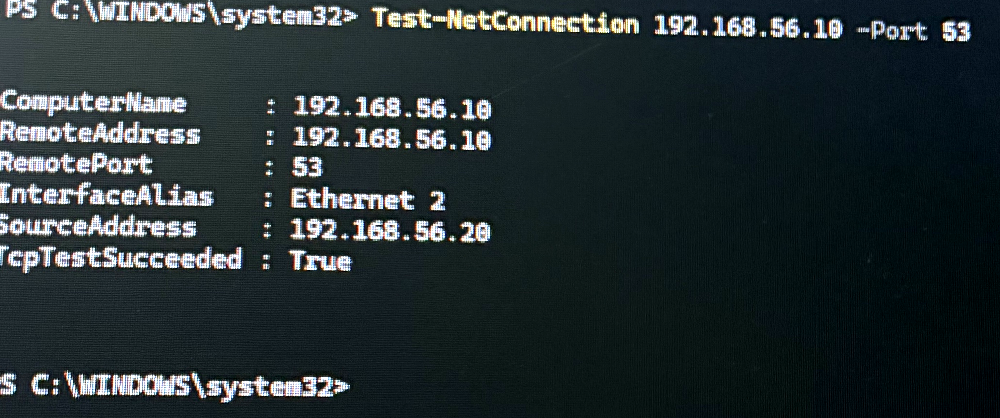
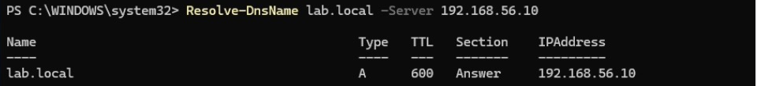
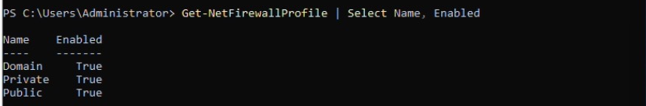

# 4. Troubleshooting: Domain Join Failure

## Problem

CLIENT02 could not find or join the `lab.local` domain. The join failed with an error that the domain controller could not be contacted.

## Investigation

1. Checked CLIENT02's IP configuration with `ipconfig /all`.
2. Found two misconfigurations on the host-only adapter:
   - **Subnet mask** was `255.255.0.0` instead of `255.255.255.0`
   - **DNS** was not pointing at the domain controller

## Root cause

Active Directory clients find domain controllers by querying DNS for SRV records (for example `_ldap._tcp.dc._msdcs.lab.local`). Those records only exist on DC01's DNS server. With DNS pointing elsewhere, the client had no way to locate the domain, so the join could never succeed. The wrong mask also meant the client's network didn't match the lab subnet.

## Fix

Set the host-only adapter on CLIENT02 to:

| Setting | Value |
|---|---|
| Subnet mask | `255.255.255.0` |
| Preferred DNS | `192.168.56.10` (DC01) |

## Verification

```powershell
# Can the client reach the DC's DNS service? (TCP port 53)
Test-NetConnection 192.168.56.10 -Port 53

# Can the client resolve the domain using the DC's DNS?
Resolve-DnsName lab.local -Server 192.168.56.10
```

Both succeeded, and the domain join went through.

`Test-NetConnection` confirmed CLIENT02 (now correctly at `192.168.56.20` on the host-only adapter, `Ethernet 2`) could reach DNS on DC01:



`Resolve-DnsName` confirmed the client could resolve `lab.local` to the domain controller:



## Firewall test

To rule out the firewall, I temporarily turned off Windows Firewall on DC01 and tested again. I then **turned it back on** and confirmed DNS resolution and domain logons still worked, which showed the firewall wasn't the problem and that the default DC firewall rules already allow the traffic AD needs. Disabling a firewall should only ever be a short, controlled test.

Confirming all three firewall profiles on DC01 were back on:



## Lesson

When a machine can't join or find a domain, check DNS first. The client must use the domain controller as its DNS server.
