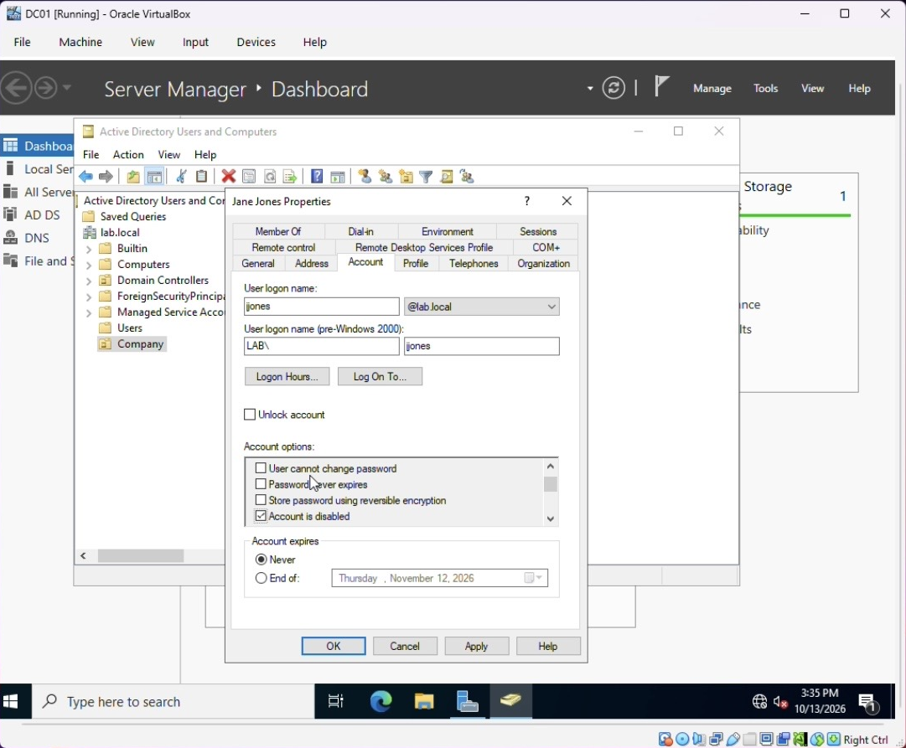

# 5. Help Desk Ticket: Password Reset

| Field | Details |
|---|---|
| Ticket | #0001 |
| User | Jane Jones (`jjones`) |
| Category | Account / Password |
| Priority | Medium |
| Status | Resolved |

## Issue

User reported she forgot her password and could not log in to CLIENT02.

## Resolution

1. On DC01, opened **Active Directory Users and Computers**.
2. Navigated to **Company → Jane Jones**.
3. Right-clicked → **Reset Password**, set a temporary password, and checked **Unlock the user's account**.
4. (Best practice) Required the user to change the password at next logon.

The **Account** tab of the user's properties is where help desk staff check the account's state: whether it's locked out (the *Unlock account* box), disabled, or set to expire.

## Verification

Logged in on CLIENT02 as `LAB\jjones` with the new password. Login succeeded.

## Notes

In a production environment, verify the user's identity before resetting a password, and never send the new password over an insecure channel.

PowerShell equivalent: [`scripts/04-password-reset.ps1`](../scripts/04-password-reset.ps1)
